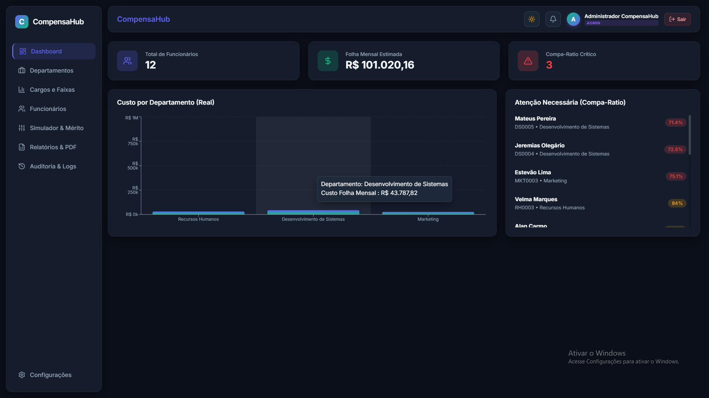
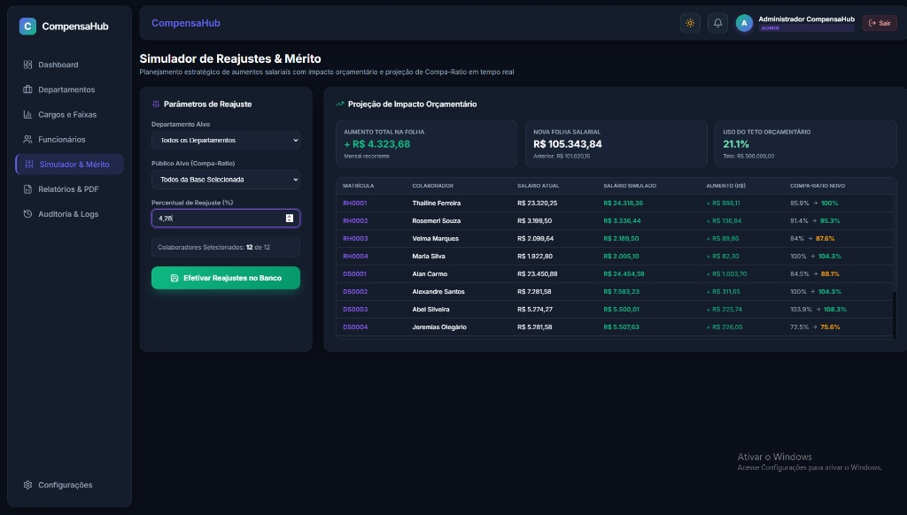
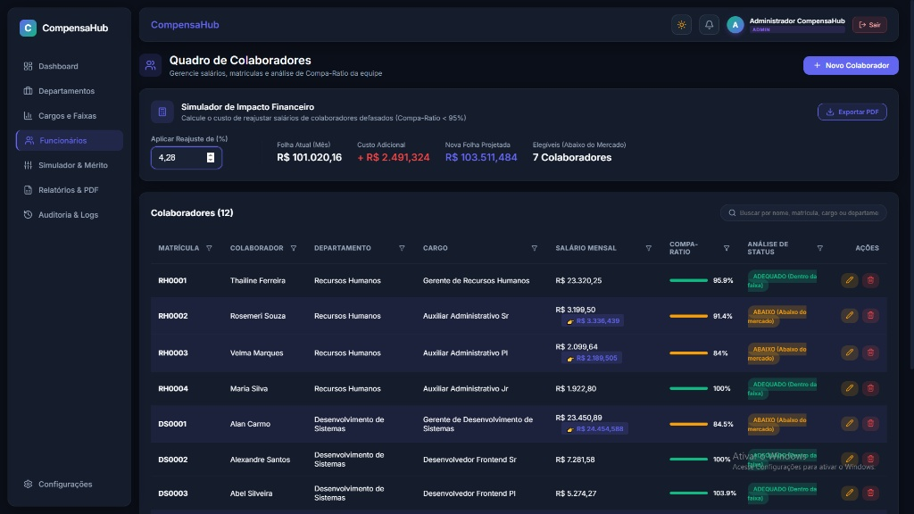
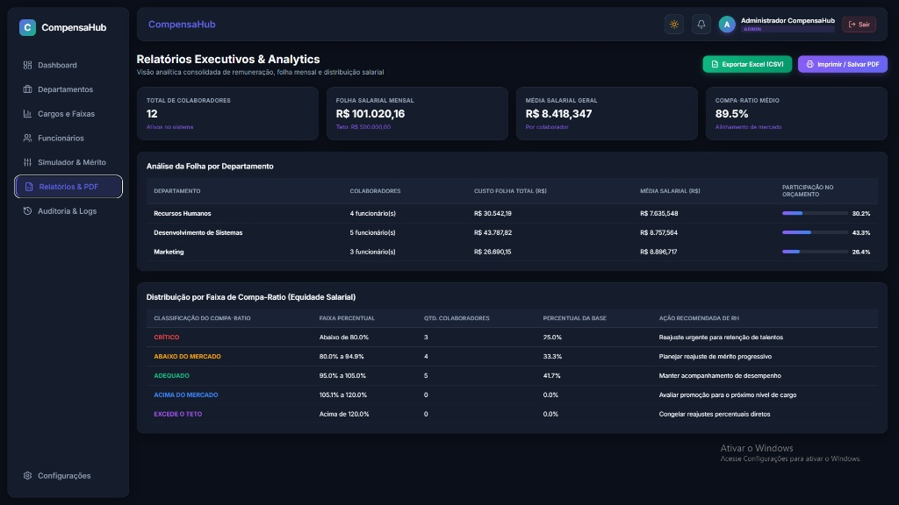
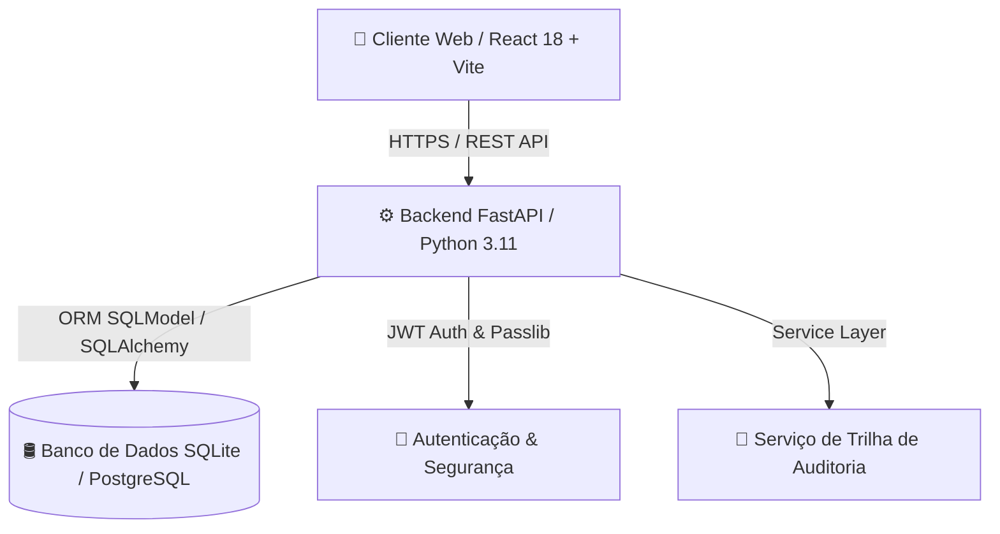

# 💼 CompensaHub — Plataforma de Gestão de Cargos e Remuneração

> Sistema B2B web que centraliza a gestão de estrutura salarial, 
> substituindo planilhas complexas por simulações de impacto financeiro, 
> análise de equidade e relatórios executivos automatizados.

## 🎬 Demo

[](https://www.youtube.com/watch?v=RCGUV0HtbPk)  
*Acesse o ambiente de demonstração ao vivo ou assista ao tour guiado de 2 minutos pelas funcionalidades da plataforma.*

## 📸 Screenshots

| 📊 Dashboard Executivo | 🧮 Simulador de Reajustes |
| :---: | :---: |
|  |  |

| ⚖️ Análise de Equidade (Compa-Ratio) | 📄 Relatório Executivo e PDF |
| :---: | :---: |
|  |  |

## 🧠 O Problema que Este Software Resolve

Nas organizações modernas, a gestão de cargos, salários e orçamentos de pessoal ainda é realizada, em grande parte, por meio de centenas de planilhas isoladas e descentralizadas. Esse modelo gera grave vulnerabilidade operacional: cálculos de impacto financeiro demoram dias para serem consolidados, atualizações manuais frequentemente introduzem erros custosos e a liderança carece de visibilidade em tempo real sobre a saúde salarial da empresa.

Quando um diretor de RH precisa planejar o ciclo anual de aumentos por mérito ou avaliar o impacto financeiro de um dissídio coletivo, o processo costuma ser moroso e propenso a falhas. Planilhas não possuem controle de versão seguro, expõem dados confidenciais de remuneração a acessos indevidos e não fornecem diagnósticos instantâneos sobre defasagem salarial (Compa-Ratio) ou equidade interna entre colaboradores que exercem funções equivalentes.

O **CompensaHub** resolve essa dor eliminando definitivamente as planilhas manuais. A plataforma centraliza a estrutura de cargos e faixas salariais em um ambiente B2B seguro e intuitivo, permitindo simular reajustes em tempo real com cálculo automático de impacto orçamentário, identificar instantaneamente colaboradores com salários críticos ou defasados em relação ao mercado e exportar relatórios executivos prontos para tomada de decisão em nível de conselho e diretoria.

## ✨ Funcionalidades Principais

- ✅ **Gestão de cargos com faixas salariais versionadas**: Estruturação completa de departamentos, cargos, faixas percentuais de amplitude e histórico de parâmetros.
- ✅ **Simulador de impacto de reajustes com projeção anual**: Simulação em tempo real de mérito e aumentos gerais com validação automática de teto orçamentário e efetivação no banco de dados com 1 clique.
- ✅ **Análise de equidade salarial (Compa-Ratio)**: Diagnóstico automático do posicionamento salarial de cada colaborador em relação ao ponto médio (*Midpoint*) do mercado.
- ✅ **Dashboard executivo com KPIs em tempo real**: Indicadores visuais de custo total de folha, média salarial geral, Compa-Ratio médio corporativo e distribuição de colaboradores por departamento.
- ✅ **Relatórios PDF profissionais para diretoria**: Geração automatizada de relatórios em layout pronto para impressão/salvamento em PDF e exportação de dados para planilhas CSV.
- ✅ **Trilha de auditoria e governança imutável**: Registro detalhado de todas as alterações salariais e cadastrais com identificação do usuário, e-mail, data/hora e comparativo (*Diff*) de atributos.
- ✅ **Alternância de Tema (Light / Dark Mode)**: Interface visual moderna em estilo Glassmorphism com alto contraste e acessibilidade em ambos os temas.

## 🏗️ Arquitetura e Tecnologias



### Lista de Tecnologias

- **Frontend**:
  - React `18.2.0` (Vite `5.1.0`)
  - React Router DOM `6.22.0`
  - Lucide React `0.344.0` (Iconografia vetorial moderna)
  - Recharts `2.12.0` (Gráficos interativos)
  - Vanilla CSS Modules (Design Glassmorphism com suporte nativo a temas Claro/Escuro)
- **Backend**:
  - Python `3.11+`
  - FastAPI `0.110.0` (Framework assíncrono de alta performance)
  - SQLModel `0.0.16` (ORM tipado baseado em Pydantic e SQLAlchemy)
  - Uvicorn `0.28.0` (Servidor web ASGI)
  - PyJWT `2.8.0` + Passlib `1.7.4` (Autenticação JWT e criptografia bcrypt)
- **Infraestrutura**:
  - Docker & Docker Compose
  - SQLite (Desenvolvimento) / PostgreSQL (Produção)

## 📐 Regras de Negócio Implementadas

1. **Cálculo Oficial de Compa-Ratio**:
   $$\text{Compa-Ratio (\%)} = \left( \frac{\text{Salário Atual do Colaborador}}{\text{Ponto Médio (Midpoint) da Faixa do Cargo}} \right) \times 100$$
2. **Classificação de Equidade Salarial**:
   - **Crítico**: Compa-Ratio $< 80.0\%$ (Alto risco de rotatividade).
   - **Abaixo do Mercado**: $80.0\% \le \text{Compa-Ratio} < 95.0\%$ (Elegível para mérito).
   - **Adequado**: $95.0\% \le \text{Compa-Ratio} \le 105.0\%$ (Alinhado ao mercado).
   - **Acima do Mercado**: $105.0\% < \text{Compa-Ratio} \le 120.0\%$ (Candidato à promoção).
   - **Excede o Teto**: Compa-Ratio $> 120.0\%$ (Necessidade de congelamento temporário).
3. **Trava de Teto Orçamentário na Simulação**:
   Bloqueia a efetivação de reajustes no banco de dados se a nova folha projetada ultrapassar o teto orçamentário configurado (*Budget Cap*).
4. **Governança e Rastreabilidade Completa**:
   Cada alteração cadastral ou salarial gera automaticamente um log no histórico de auditoria contendo o usuário logado, seu e-mail, data/hora oficial e o detalhamento de campos alterados.

## 🚀 Como Executar

### Pré-requisitos
- [Docker](https://www.docker.com/) e [Docker Compose](https://docs.docker.com/compose/) instalados  
*ou* Node.js 18+ e Python 3.11+ para execução local.

### Execução via Docker (Recomendado)

```bash
# 1. Clone o repositório
git clone https://github.com/alan-carmo/compensahub.git
cd compensahub

# 2. Suba a aplicação com Docker Compose
docker-compose up -d

# 3. Acesse no seu navegador
# Frontend: http://localhost:3000
# API Swagger Docs: http://localhost:8000/docs
```

### Execução Manual Local

#### 1. Backend (FastAPI)
```bash
cd backend
python -m venv venv

# Windows:
.\venv\Scripts\activate
# Linux/Mac:
# source venv/bin/activate

pip install -r requirements.txt
uvicorn app.main:app --reload --port 8000
```

#### 2. Frontend (React)
```bash
cd frontend
npm install
npm run dev
# Acesse http://localhost:5173
```
